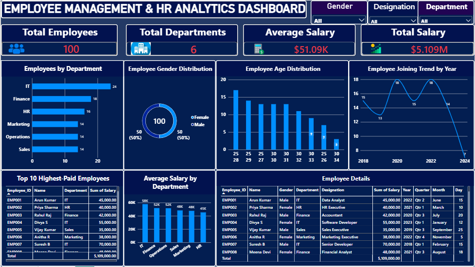

# Employee Management & HR Analytics System

A desktop-based employee management application integrated with MySQL and a Power BI dashboard to manage employee records and generate meaningful HR insights.

## Project Overview

The Employee Management & HR Analytics System combines employee record management with HR data analysis. The application is built using Python and Tkinter, with MySQL as the database and Power BI for interactive dashboard reporting.

This project demonstrates practical skills in desktop application development, database management, SQL, data analysis, and business intelligence.

## Business Objectives

- Centralize employee information in a structured database.
- Simplify employee record management.
- Enable employee-specific information access.
- Analyze workforce demographics and departmental distribution.
- Understand salary distribution and employee joining trends.
- Present HR metrics through interactive Power BI visualizations.

## Technology Stack

| Technology | Purpose |
|---|---|
| Python | Application logic and data processing |
| Tkinter | Desktop graphical user interface |
| MySQL | Relational database management |
| SQL | Database queries and employee data operations |
| Power BI | HR analytics and dashboard visualization |
| Pandas / Excel | Not used as core application dependencies |

## Key Features

### Employee Management
- Add new employee records
- Update existing employee information
- Delete employee records
- Search employee details
- View employee information in a structured table
- Export employee records to CSV

### Authentication
- Separate Admin and Employee login interfaces
- Admin access to employee management features
- Employee access to employee-specific information

### Database Integration
- MySQL database connectivity
- Structured employee records
- SQL-based data retrieval and modification
- Employee login table linked to employee records

### HR Analytics Dashboard
The Power BI dashboard presents key workforce metrics and visualizations.

**Key Performance Indicators (KPIs)**
- Total Employees
- Total Departments
- Average Salary
- Total Salary

**Analytical Visualizations**
- Employee distribution by department
- Gender distribution
- Employee age distribution
- Employee joining trends by year
- Average salary by department
- Top 10 highest-paid employees
- Employee details table
  
### Dashboard Preview

## HR Analytics Dashboard Preview



## System Architecture

1. **Presentation Layer:** Tkinter desktop interface
2. **Application Layer:** Python application logic and validation
3. **Data Layer:** MySQL database and SQL queries
4. **Analytics Layer:** Power BI dashboards and HR reporting

## Database Design

The project uses an `employees` table containing employee information such as:

- Employee ID
- Name
- Date of Birth
- Date of Joining
- Gender
- Department
- Designation
- Salary
- Contact
- Email
- Address

An `employee_login` table supports employee authentication and references employee records through `Employee_ID`.

## Project Structure

```text
employee-management-hr-analytics/
│
├── employee_management.py
├── README.md
├── .gitignore
├── database/
│   └── employee_management.sql
└── dashboard/
    ├── HR_Analytics_Dashboard.pbix
    └── HR_Analytics_Dashboard.png
```

## Installation and Setup

### Prerequisites
- Python 3
- MySQL Server
- MySQL Workbench (recommended)
- Power BI Desktop
- Git (optional)

### 1. Clone the Repository

```bash
git clone https://github.com/prabinksraj-ops/employee-management-hr-analytics.git
cd employee-management-hr-analytics
```

### 2. Install Python Dependencies

```bash
pip install mysql-connector-python python-dotenv
```

### 3. Configure Environment Variables

Create a local `.env` file in the project directory. Add your own MySQL and admin credentials:

```env
ADMIN_USERNAME=your_admin_username
ADMIN_PASSWORD=your_admin_password

DB_HOST=localhost
DB_NAME=employee_management
DB_USER=your_mysql_username
DB_PASSWORD=your_mysql_password
```

Replace the example values with your local configuration. Never commit the `.env` file or real credentials to GitHub.


### 4. Set Up the Database

1. Start MySQL Server using MySQL Workbench.
2. Open the `database/employee_management.sql` file in MySQL Workbench.
3. Execute the SQL script to create the `employee_management` database and its tables.
4. Confirm that the `employees` and `employee_login` tables are created successfully.
5. Configure your local `.env` file with the correct MySQL credentials.

**Note:** The SQL script creates the database tables. It does not include real employee records or login credentials.

### 5. Run the Application

```bash
python employee_management.py
```

### 6. Open the Power BI Dashboard

Open the `.pbix` file using Power BI Desktop. Configure the data source and refresh the data if required.

## Security Considerations

- Store credentials in a local `.env` file.
- Exclude `.env` and other sensitive configuration files from version control.
- Do not publish real employee personal information or confidential company data.
- Use sample or anonymized data when sharing this portfolio project.

## Skills Demonstrated

- Python application development
- Tkinter GUI development
- MySQL database integration
- SQL queries and relational data modelling
- CRUD operations
- Authentication interface development
- Data visualization and HR analytics
- Power BI dashboard design
- KPI reporting and business insights
- Git and GitHub project documentation

## Future Enhancements

- Password hashing and stronger authentication
- Role-based access control
- Improved input validation and error handling
- Automated Power BI data refresh
- Advanced HR analytics and reporting

## Author

**Prabin Raj**

Aspiring Data Analyst | SQL | Python | Power BI | Excel

GitHub: [prabinksraj-ops](https://github.com/prabinksraj-ops)

---

*This project was developed for learning and portfolio demonstration purposes using sample employee data.*
